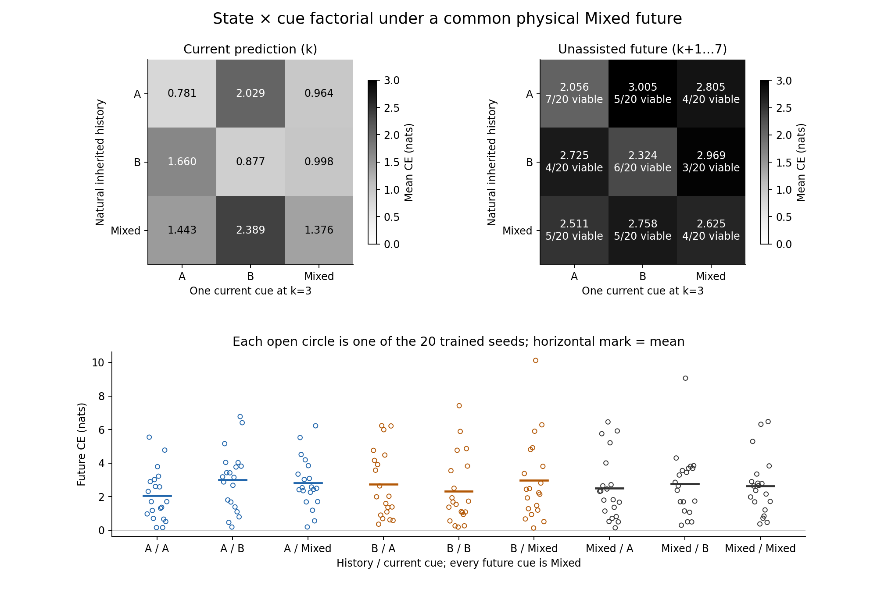
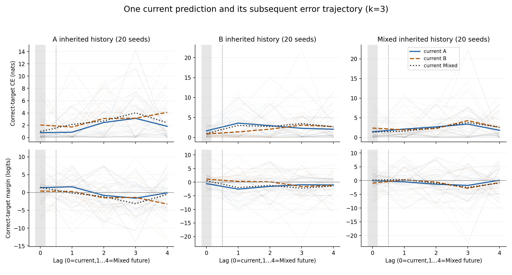
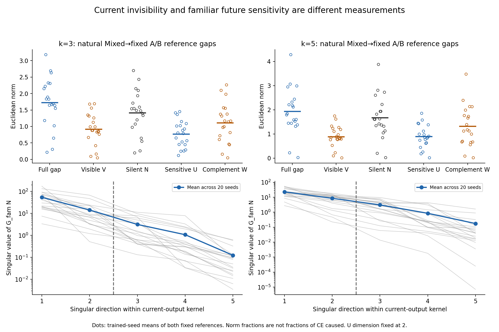
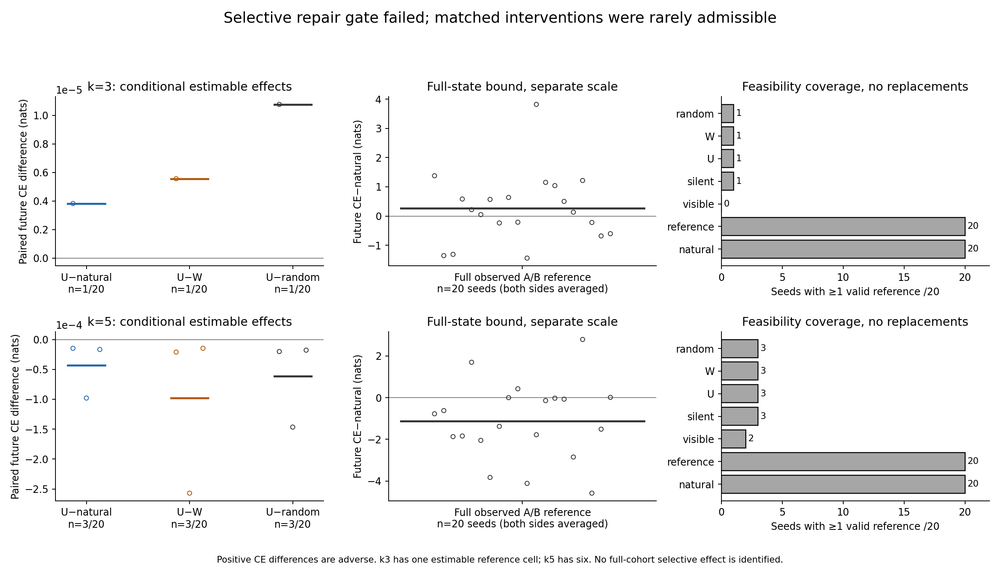
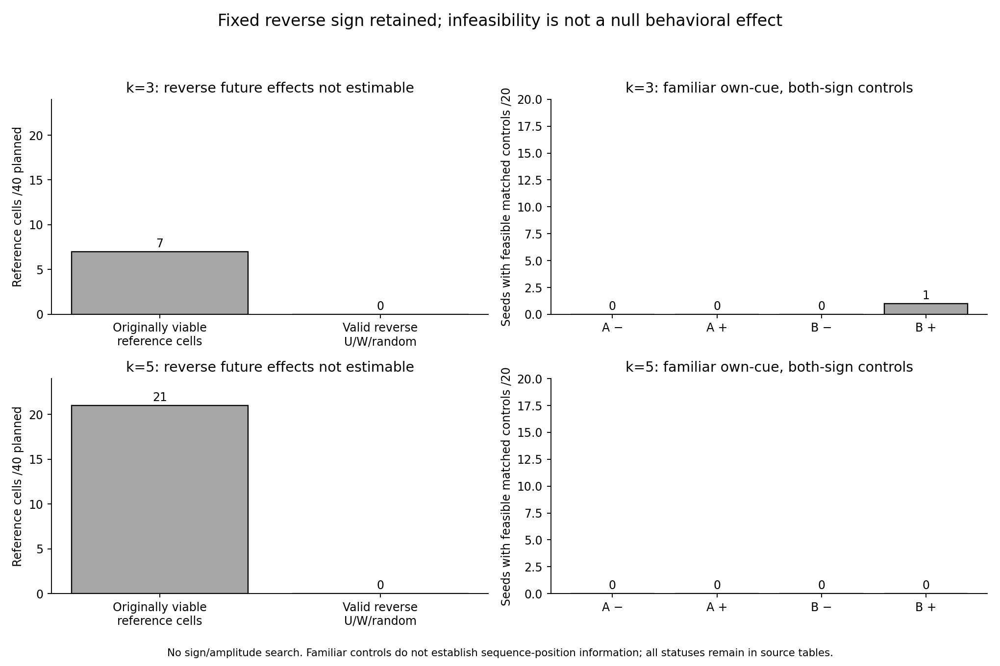

# Context failure and selective repair — final report

**What failed?** Natural physical Mixed produces mean next-token CE 2.248301 nats versus A 0.917284 and B 1.455810. Holding the current and future cue at Mixed, familiar inherited histories do not give a clear mean k3 future advantage: the paired A/B-reference mean difference is +0.262313 nats,95% trained-seed interval[-0.222091,0.816107]. Changing only the current familiar cue to Mixed increases subsequent mean CE within A history by0.749261[0.329812,1.183521] and within B history by0.645418[0.005686,1.404572]. The latter cue contrasts have descriptive unadjusted intervals. The consequences of the current input depend on inherited state; these experiments do not identify a unique hidden pathway.

**What was disrupted?** No selective recurrent computation was identified. The output map has a five-dimensional current-softmax kernel. Familiar-only derivatives define a fixed two-dimensional future-sensitive subspace, but projected natural-gap norms are measurements of local sensitivity, not amounts of sequence information lost or CE caused.

**What caused the deficit?** The selective causal explanation remains unestablished. At k3 only1/40 A/B reference cells, representing1/20 seeds, permits the registered matched U/W/random intervention. This seed12/A case has U−natural=+3.828413e-6 nats, U−W=+5.567129e-6 and U−random=+1.077161e-5: tiny adverse effects. The full-cohort selective gate fails. No reverse matched perturbation is feasible at either position. This is a feasibility-limited outcome, not evidence of a zero reverse effect or of absent hidden capacity.

**What can be learned from this?** Recommend **no new training experiment**. First inspect the fixed rays against the saved tanh-interior geometry under a separate diagnostic protocol. Do not relax the margin, clip states, retune dimensions, resample controls or train until a favorable result appears.

**We localized effects of state history and context on future performance, but did not identify a unique disruption whose correction explains the natural Mixed deficit.**

## Frozen protocol and exact evidence

Exactly20 original canonical High_monotonic checkpoints at original170; no C0/C1–C3, Low, D3 endpoint or sequence-only pooling. Seven teacher-forced token inputs(0,1,2,0,3,1,2) predict(1,2,0,3,1,2,3). h0=0; k is the output after consuming x_k. A=(1,0,0), B=(0,1,0), physical Mixed=(.5,.5,0). Third cue weights are zero. Only original next-token logits are scored; the separate monotonic execution policy is not a prediction head.

R0 verifies20 checkpoint hashes and all predecessor scientific seals/source files. Sixty natural A/B/M rollouts and16 representative branch tails were used only for fidelity at1e-12 CSV tolerance; every reused natural baseline was checked. R1 reuses all360 exact P4 pulse cells and1440 transition rows, with **zero new factorial scientific evaluations**. The optional Phase1K CSVs are cloud-only; no observed digest is invented. The available P4 evidence supplies every required exact branch. Phase1K native-restoring pulses, persistent takeovers and geometric scores are not silently substituted.

Allnine inherited-state × current-cue cells appear at both k3(primary,4 future predictions) and k5(secondary,2 future predictions). All subsequent cues are physical Mixed. A/A and B/B cells have familiar current outputs but counterfactual Mixed futures; they are not full-familiar trajectories. Both A-history/Mixed-update and B-history/Mixed-update references are retained, never selected by CE. Natural full-A/full-B gap references are separate diagnostics in R2.

## R1 — current cue, history and future

| k | endpoint | contrast | mean | ci_low | ci_high | n_valid | n_seeds | resampling_unit | status |
| --- | --- | --- | --- | --- | --- | --- | --- | --- | --- |
| 3 | current_ce | cue_A | 0.18337 | -0.099018 | 0.60187 | 20 | 20 | seed | complete_seed_support |
| 3 | current_ce | cue_B | 0.12118 | -0.12333 | 0.37714 | 20 | 20 | seed | complete_seed_support |
| 3 | current_ce | history_mean_AB | -0.39461 | -1.1613 | 0.37273 | 20 | 20 | seed | complete_seed_support |
| 3 | current_ce | interaction_A | 0.25036 | -0.15185 | 0.68681 | 20 | 20 | seed | complete_seed_support |
| 3 | current_ce | interaction_B | 1.1349 | 0.32152 | 2.141 | 20 | 20 | seed | complete_seed_support |
| 3 | future_ce | cue_A | 0.74926 | 0.32981 | 1.1835 | 20 | 20 | seed | complete_seed_support |
| 3 | future_ce | cue_B | 0.64542 | 0.0056858 | 1.4046 | 20 | 20 | seed | complete_seed_support |
| 3 | future_ce | history_mean_AB | 0.26231 | -0.22209 | 0.81611 | 20 | 20 | seed | complete_seed_support |
| 3 | future_ce | interaction_A | 0.63535 | 0.11143 | 1.1761 | 20 | 20 | seed | complete_seed_support |
| 3 | future_ce | interaction_B | 0.7786 | -0.071692 | 1.6326 | 20 | 20 | seed | complete_seed_support |

Negative CE differences favor the first branch. Inference resamples20 whole trained seeds,10,000 draws,RNG20260925. Histories, branch cells, transitions and references are repeated measures. Future CE excludes current k; full-remaining CE includes it as a secondary endpoint. Familiar viability is the unchanged predecessor `future_summary`: future mean CE≤position-specific mean familiar A/B future CE+.10, equality passes. Zero-slack and worst-step outcomes are exported.

| k | n_viable | any_viable | any_current_correct | any_current_correct_then_error |
| --- | --- | --- | --- | --- |
| 3 | 7 | 5 | 16 | 15 |
| 5 | 21 | 16 | 14 | 12 |

Counts are seed-level and nonexclusive except n_viable, which counts both reference cells. At k3,7/40 references across5/20 seeds are viable. Sixteen seeds have at least one correct current reference prediction;15 have at least one such reference followed by a later error. This does not by itself demonstrate loss of memory. At k5,21/40 references across16/20 seeds are viable; the shorter horizon and position differ, so this is secondary rather than a replication of the same estimand.

## R2 — equations and numerical meaning

The source recurrence is h_t=tanh(W_h h_(t−1)+W_x x_t+W_c c_t+b_h), z_t=W_o h_t+b_o. Let P=I−11ᵀ/4 and O=PW_o. Full right SVD yields V spanning row(O), N spanning ker(O). For d=r−h_M, d_visible=VVᵀd and d_silent=NNᵀd; their sum equals d. O d_silent=0 implies z′−z is constant across classes, hence **allfour** softmax probabilities and every possible current-target CE are identical in exact arithmetic. Current-output identity does not imply future identity, because O diag(1−h_next²)W_h N need not vanish.

For familiar g∈{A,B}, G_g(k)=∂vec(Pz_(k+1),…,Pz_7)/∂h_k. It uses natural familiar poststates, the same known future input tokens and that familiar cue, with frozen weights and **no target labels or Mixed CE**. Stack G_A/G_B; SVD of G_fam N gives fixed U=NQ[:,:2] and W=NQ[:,2:]. Both references are projected only after this geometry is frozen. All40 seed/k top-two subspaces pass the fixed singular-value/gap identification test; dimension2 is never selected by outcome.

Independent double autodiff/chain maximum disagreement=1.990e-13. Nonsaturated source finite-difference fixtures pass at1e-3 and1e-4. Across real saturated source states, maximum absolute derivative discrepancies are0.915075 and0.128025; maximum relative discrepancies are0.150853 and0.646115. Boundary one-sided flags and raw Jacobians are retained. These are numerical limitations of local double sensitivities compared with finite float32 changes, and weaken fine orientation claims; no scales or thresholds were tuned. Behavior is always scored with the original float32 source, not the double derivative model.

## R3 — selective intervention, feasibility and negative results

At natural Mixed poststate h and each fixed reference r, d=r−h. U direction is UUᵀd. The W gap projection is rescaled to the same norm; only if numerically zero is its hash fallback used. Random is a hash-seeded direction in N with that same norm. Hash identity=(20261113,seed,k,reference,control_kind). For the three matched rays, compute the largest joint feasible scale≤1 from the strict interior |h_j|≤1−1e-6, then multiply by.95. The actual interval can have a positive lower bound because a natural float32 tanh state may already lie at±1. If the safety factor violates that bound, the comparison is infeasible. No clipping or direction replacement is permitted. Visible/full-silent arms use the same scale where feasible. Exact observed full references are reused bounds, with boundary/interior status explicit; boundary states are not portrayed as strict-interior applied patches.

| k | arm | n_seed_denominator | n_reference_denominator | n_valid_seed | n_valid_references | n_viable_seed | n_viable_reference |
| --- | --- | --- | --- | --- | --- | --- | --- |
| 3 | natural | 20 | 40 | 20 | 40 | 4 | 8 |
| 3 | reference | 20 | 40 | 20 | 40 | 5 | 7 |
| 3 | visible | 20 | 40 | 0 | 0 | 0 | 0 |
| 3 | silent | 20 | 40 | 1 | 1 | 1 | 1 |
| 3 | U | 20 | 40 | 1 | 1 | 1 | 1 |
| 3 | W | 20 | 40 | 1 | 1 | 1 | 1 |
| 3 | random | 20 | 40 | 1 | 1 | 1 | 1 |
| 5 | natural | 20 | 40 | 20 | 40 | 8 | 16 |
| 5 | reference | 20 | 40 | 20 | 40 | 16 | 21 |
| 5 | visible | 20 | 40 | 2 | 3 | 0 | 0 |
| 5 | silent | 20 | 40 | 3 | 5 | 0 | 0 |
| 5 | U | 20 | 40 | 3 | 6 | 0 | 0 |
| 5 | W | 20 | 40 | 3 | 6 | 0 | 0 |
| 5 | random | 20 | 40 | 3 | 6 | 0 | 0 |

n_valid_seed means at least one valid reference, not complete both-side support. At k3 onlyseed12/A is matched feasible; k5 has both sides for seeds2,6,18. Only3/40 and5/40 full observed references respectively are in the registered strict interior. The rest remain exact observed source data. Most proposals are infeasible; failed cells are never assigned zero CE or dropped from status denominators. The short-horizon k5 effects remain conditional and cannot repair the primary coverage gate.

| group | context | sign | k | contrast | mean | ci_low | ci_high | n_valid | n_seeds | resampling_unit | status |
| --- | --- | --- | --- | --- | --- | --- | --- | --- | --- | --- | --- |
| forward | Mixed | 1 | 3 | U_minus_W | 5.5671e-06 | 5.5671e-06 | 5.5671e-06 | 1 | 20 | seed | conditional_estimable_seeds |
| forward | Mixed | 1 | 3 | U_minus_natural | 3.8284e-06 | 3.8284e-06 | 3.8284e-06 | 1 | 20 | seed | conditional_estimable_seeds |
| forward | Mixed | 1 | 3 | U_minus_random | 1.0772e-05 | 1.0772e-05 | 1.0772e-05 | 1 | 20 | seed | conditional_estimable_seeds |
| forward | Mixed | 1 | 3 | reference_minus_natural | 0.26231 | -0.22209 | 0.81611 | 20 | 20 | seed | complete_seed_support |
| forward | Mixed | 1 | 3 | silent_minus_natural | 5.7159e-08 | 5.7159e-08 | 5.7159e-08 | 1 | 20 | seed | conditional_estimable_seeds |
| forward | Mixed | 1 | 3 | visible_minus_natural | not established | not established | not established | 0 | 20 | seed | not_estimable |

A one-seed bootstrap has degenerate endpoints; it supplies no population uncertainty estimate and is **not** evidence for a cohort effect. All available current-softmax checks pass: largest applied silent double discrepancy=2.220e-16; source float32 discrepancy=2.849e-07, below its predeclared P2 arithmetic bound. It is not bitwise identity. `r5_source_cast_audit.csv` separately records float32 state quantization; some realized displacements are very small, so arithmetic size matters.

Only33 new patch rollouts were executed across forward and familiar controls; reverse0. The320 planned reverse rows retain baseline/eligibility/infeasibility, including all7 and21 originally viable reference cells. No matched reverse comparison is estimable. Familiar both-sign controls keep A/B future cues. Only one seed/reference/context/sign cell (seed12/A-reference, B future,+ sign) has a valid matched familiar test at k3; none at k5. This is insufficient to establish preserved familiar competence or a trade-off for the cohort. Full per-step CE/probabilities, worst-step losses and actual prefix+current+future full-sequence costs are saved separately.

## Primary figures

Figure1: allnine k3 cells, current/future separately; dots are20 trained seeds, and viable counts use the registered future criterion.

Figure2: cue-specific CE and correct-target margins, lag0 separate from the common Mixed future. Thin lines retain individual seeds.

Figure3: both fixed reference sides averaged within seed, raw gap/component norms and all singular spectra. Silent norm contains U/W components; it is not an additive CE decomposition.

Figure4: conditional U contrasts, full-reference bound and explicit feasibility denominators. Sparse effects are not made to look like full20 support.

Figure5: zero estimable reverse comparisons shown as feasibility counts, not zero behavioral effects. Both familiar signs remain explicit.

## Interpretation, uncertainties and stopping decision

The factorial causally localizes effects of one current cue under identical subsequent inputs and frozen recurrence, with substantial seed dependence. A useful immediate output does not ensure maintained prediction. Familiar inherited states are not a general solution to a common Mixed future. The present protocol does not isolate a unique disruption: it cannot distinguish distributed effects, an inadequate familiar-derived U, nonlinear sensitivity changes, or a feasible-intervention limitation. It does not establish absent sequence information, a global accessibility boundary, autonomous generation, long-run stability, a human neural mechanism or an attractor.

No training, optimizer update, cue optimization or hidden-state optimization occurred. Original model bytes remain unchanged. R4 is design only and recommends no new training. No threshold, rank, margin, sign, reference or budget was changed after unfavorable outcomes. All negative/blocked/inconclusive cases remain evidence.

## Tests, provenance and reproduction

RED behavioral tests preceded every stage; GREEN and REFACTOR logs are indexed with SHA256 in `tables/r5_test_evidence.csv`. Independent table checks recompute every R1 cell, all paired R3 contrasts and every registered bootstrap from seed rows. 34 new tests and57 independent read-only predecessor tests passed. Phase1K: collection/import remained blocked in bounded retries; exact status {"status": "blocked_import_timeout45", "scientific_updates": 0, "source_unchanged": true}. No Phase1K pass is claimed. Source and predecessor data were not modified. Read-only predecessor P2/P4/D1/S3 results are in `audit/predecessor_readonly_green.log`; the interrupted initial combined invocation is preserved separately in `audit/predecessor_regression.log`. Phase1K bounded diagnostics/final status are in `audit/phase1k_*`. Tests18/19 replay170 training updates and are deliberately excluded. Import/cache workarounds change no scientific code; any remaining blocker is explicit.

The initial v1 R2 run was superseded by v1_1 after a precision error in a synthetic test and a shell failure to stop on RED. The original failing logs and test snapshot remain in v1; only the test’s weight averaging was corrected from float32 to float64, with tolerance unchanged. The scientific algorithms and thresholds did not change. R0/R1 outputs were copied byte-for-byte and hash-verified; R2 was rerun only after GREEN. The accepted scratchpad uses PRD sections because the named template was unavailable; the user explicitly accepted this.

See `audit/frozen_inputs.json` for exact source/data hashes, `tables/r0_checkpoints.csv` for all20 checkpoints, `tables/r0_reuse_registry.csv` for360 provenance rows, `tables/r5_claim_sources.csv` and `CLAIM_LEDGER.md` for source-to-claim hashes. Stage manifests are immutable. Final seal rejects missing, changed or extra scientific bytes; only Finder .DS_Store metadata is explicitly excluded.

Read-only final verification: `PYTHONPATH=.:src python -m experiments.context_failure_selective_repair.verify --output results/context_failure_selective_repair/v1_1`.

Table-only regeneration to a new empty destination: `PYTHONPATH=.:src OPENBLAS_NUM_THREADS=1 OMP_NUM_THREADS=1 python -m experiments.context_failure_selective_repair.regenerate --source results/context_failure_selective_repair/v1_1 --destination /tmp/context_failure_regenerated`. It verifies the seal, makes no model calls, recreates five PNG/SVG figures, reports and derived tables, and compares every product hash.
