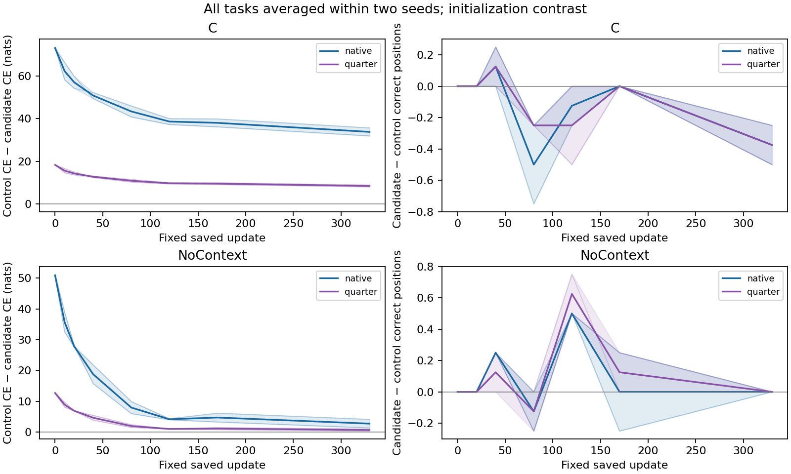
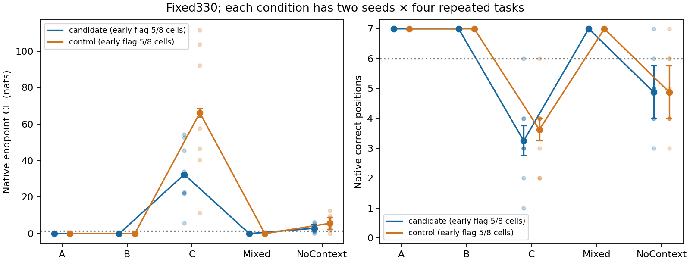

# Verified selected cached analysis: confidence versus correctness

The candidate's C/NoContext cross-entropy advantage was already present at
initialization and was smaller at update330. Most endpoint loss improvement came
from positions that remained wrong. Both native conditions learned A/B and
physical Mixed well, but neither achieved the unchanged same-network four-outcome
criterion. This counters the registered learned-onset prediction and retains a
narrower descriptive result about error expression.

The exact [38-file result bundle](../../../artifacts/selected-analysis-results.zip)
was retrieved from GitHub commit
[c8e1301](https://github.com/mohanwugupta/Contexts-FTT-Tiny-RNN/commit/c8e130101a32fc04c3a9c376b1fabcc12095e77e).
This report is a separately versioned verification; earlier user-reported results,
failed execution receipts and recovered outputs are preserved unchanged. No model,
worker or optimizer was rerun. All new computations are saved-table arithmetic.

## Fixed comparison and independent unit

Sixteen archived zero-prior H8 histories: half-scale initial readout candidate
versus scale1 control, two paired initialization seeds21000/21001 and four repeated
development tasks per seed. Registered updates0,10,20,40,80,120,170,330; cues A/B/C,
physical Mixed-average and NoContext; seven positions; four logits/probabilities;
native and checkpoint-specific bias-retaining quarter-readout views. Loss is mean CE across the seven positions. No checkpoint,
cue, task or seed was selected from the results.

Positive gain means control CE minus candidate CE, or native CE minus quarter CE
for the within-network expression comparison. The original thresholds remain
CE<=0.5 and at least6/7 correct for each required cue, plus the unchanged original
early phenotype, within the same native network/task. Static readout views are not
additional trained networks. Eight task rows per condition represent only two
independent initialization seeds. Four tasks are averaged within seed before the
original10000-draw bootstrap (fixed resampling seed20260925).

## Main results

| Cue | Native CE advantage at0 | Native CE advantage at330 | Change since0 | Candidate newly correct / newly wrong at330 |
|---|---:|---:|---:|---:|
| C |73.238170|33.791020|−39.447150|0 /3|
| NoContext |50.880448|2.730757|−48.149691|1 /1|

These are cohort means from the exact saved tables, with six-decimal display.
The native advantage is positive at all eight registered times for both cues.
The endpoint reduction occurs in both seed means: C advantages31.899690/35.682351
at330 versus72.772555/73.703785 at0; NoContext1.334102/4.127412 versus
51.244808/50.516088. NoContext is not monotonically declining: its advantage rises
slightly from120 to170. Interim correctness differences also vary in sign.

The descriptive seed-bootstrap95% intervals at330 are C CE advantage
[31.899690,35.682351], NoContext[1.334102,4.127412]; changes since0 are
C[−40.872865,−38.021434] and NoContext[−49.910706,−46.388676]. With only two
independent seeds, these intervals should not be read as strong population-level
evidence or replication across eight networks. All seed/time values and signs are
in [the verified seed table](tables/verified_seed_time_summary.csv).

Figure1: candidate/control contrasts for native and static quarter views. Faint
seed means and bootstrap bounds retain all fixed checkpoints. The quarter curve
is an expression control on saved trajectories, not another learned condition.
[SVG](figures/fixed_time_initialization.svg),
[exact checkpoint means](tables/verified_checkpoint_summary.csv).

| Native330 mean | Candidate | Control |
|---|---:|---:|
| Familiar A/B CE |0.0000893745|0.0000314559|
| C CE |32.442822|66.233842|
| C correct positions |3.250 /7|3.625 /7|
| Mixed CE |0.0000580335|0.00000243945|
| NoContext CE |2.935631|5.666388|
| NoContext correct positions |4.875 /7|4.875 /7|
| Familiar qualification |8/8 cells|8/8 cells|
| Original early phenotype |5/8 cells|5/8 cells|
| C usefulness |0/8 cells|0/8 cells|
| Mixed usefulness |8/8 cells|8/8 cells|
| NoContext usefulness |1/8 cells|1/8 cells|
| Same-network four-outcome success |0/8 cells|0/8 cells|

All native A/B/Mixed predictions are7/7 at330. Their successful acquisition does
not remove the C/NoContext failure. Mean native C and NoContext CE remain above
the ln(4)=1.386294 chance reference in both conditions. Do not interpret those
cohort means as a statement that every individual row exceeds chance.

Figure2: every task row and task-averaged seed intervals, native networks only.
The5/8 early counts do not establish persistent separate learning at endpoint;
late functional status and screen preservation remain unassessed/unresolved.
[SVG](figures/native_outcomes.svg),
[all16 native task rows](tables/native_seed_task_metrics.csv),
[exact condition means](tables/native_condition_means.csv).

## Which positions supply the loss improvement?

Among56 matched positions per cue (8task rows x7positions), C has27 both wrong,
26 both correct,3 newly wrong and0 newly correct. The both-wrong category supplies
34.001872nats of mean CE improvement; newly wrong positions subtract0.210744 and
both-correct positions subtract0.000107. Thus both-wrong improvement exceeds the
net33.791020 because other categories offset it.

NoContext has16 both wrong,38 both correct,1 newly correct and1 newly wrong.
Both-wrong improvement supplies2.467206nats of the net2.730757; newly correct adds
0.289293, newly wrong subtracts0.016215, and both correct subtracts0.009527. Category
contributions use sums divided by all seven positions within each task, then mean
over tasks; they are not unweighted means within categories.

Static quarter-readout at330 produces no correctness flips for C or NoContext in
either condition. It lowers C CE by24.396384(candidate)/49.801736(control), and
NoContext by2.011449/4.085448. It also slightly worsens already excellent familiar
and Mixed CE while retaining their correct decisions. See
[endpoint static accounting](tables/endpoint_static_accounting.csv) and
[all initialization categories](tables/verified_category_summary.csv).

## Mathematical and scientific interpretation

If native logits are z=W_out h+b, the archived static quarter view is
z_q=b+0.25(z-b). It leaves each saved hidden trajectory fixed but retains the
class-specific output bias. It can therefore change argmax, unlike positive
pure temperature scaling z/T. The observed absence of endpoint flips is a result,
not a general invariance theorem.

Cross-entropy is log(sum_j exp(z_j))-z_target. Softening a strongly wrong prediction
can reduce its loss while leaving the predicted class wrong. The category
accounting and static expression control support this limited explanation here.
They do not establish calibrated confidence, a causal learning mechanism, a shared
memory retrieval process, or a human mechanism. Native candidate/control histories
can have different hidden trajectories after training.

The registered prediction explicitly named an advantage already established at0
as counterevidence. That counterevidence is present, and the endpoint advantage
also shrinks. Retain the expression phenomenon and failed joint phenotype rather
than presenting the original learned-onset hypothesis as confirmed. The proposed
held-out temperature-versus-bias-retaining comparison remains design only; no
follow-up or additional model call is authorized by this report.

## Verification, execution and remaining limits

Verified: exact Git blob and ZIP CRC for38entries; all31 recovered worker-file
hashes and10 native manifest hashes; five pinned selected-code hashes;139 original
input hashes; all8960 saved position records against original archived CSVs;
all four logits/probabilities, CE, margins and decisions; six paired/category/
baseline tables; task-averaged two-seed intervals;112 original flag comparisons;
all16 full frozen trajectories and same-network classifications. Primary PNG/SVG
figures were copied byte-identically and visually inspected. See
[VERIFICATION.json](VERIFICATION.json), [claim ledger](CLAIM_LEDGER.md), and
[table-only reproduction](REPRODUCE.md).

The worker used12.964861509CPU seconds under120 and37.276164146wall under300.
Docker timestamps place its execution within the new14:29:28.767376–14:59:28.767376
UTC authorization window on November25,2026. This verifies container timing, not
every unobserved parent-model action. All19 container checks plus evidence-write
denial passed. No new model forward or optimizer step occurred.

The parent launcher still exited1 after worker success while hashing native/
evaluation_result.json. The original job FILES.json was not written. Read-only
recovery preserved the output bytes; its complete hash manifest now verifies.
The passed field in the job receipt describes the worker stage, not an error-free
end-to-end export. Source inspection and a synthetic fixture show that the native
atomic writer creates0600JSON files, consistent with the cross-identity read
failure. Fix collection/export separately; do not rerun the scientific worker.

Preserve accounting history: RUN_SPEC.json contains the old09:00UTC/100000
planning snapshot and is historical. The later authorization.json supplies the
new execution window but still records stale87000 prior holds, omitting the
previous13000 attempt. The owner-approved ledger is100000 prior holds+17000 new
reserve=117000 registered holds. The stale records are retained, not silently
rewritten. Actual input/output/cached tokens and intervening setup usage remain
unknown;117000 is not measured consumption or a provider-enforced cap.

This is a completed, independently verified cached numerical analysis with
recovered export and a supervised critique. Full parent/critic isolation, complete
provider accounting and fully automatic output collection remain unverified or
failed. It does not establish readiness for the sealed72-hour campaign, which
remains unchanged and unlaunched.
